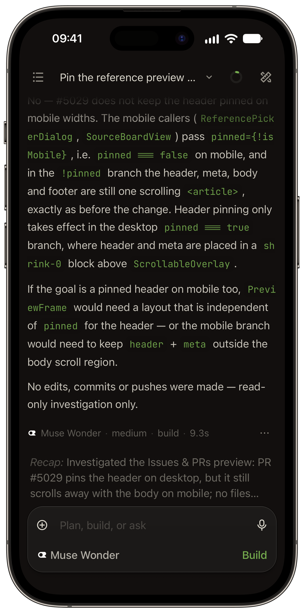
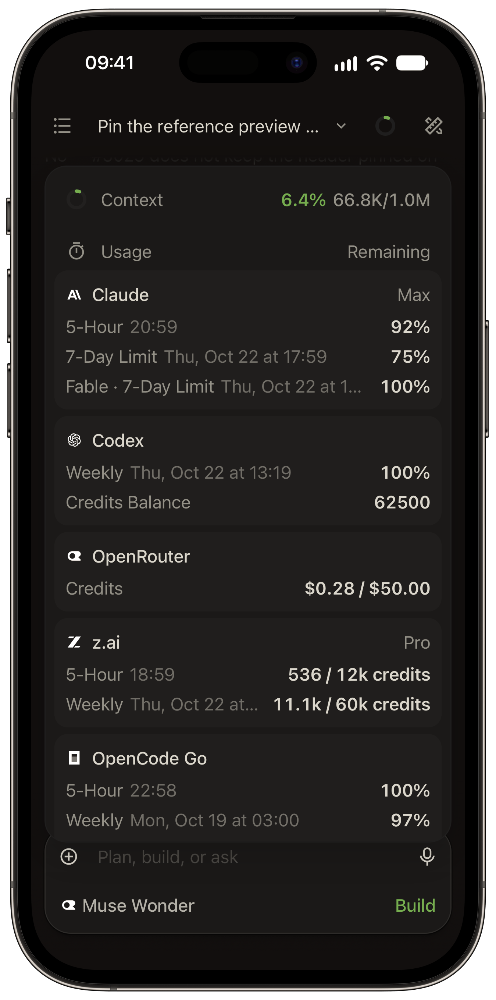

# <picture><source media="(prefers-color-scheme: dark)" srcset="docs/references/badges/alcode-logo-dark.svg"></picture> Alcode

[](https://github.com/dang232/Alcode/stargazers)
[](https://github.com/dang232/Alcode/releases/latest)
[](https://github.com/dang232/Alcode/actions/workflows/oc-review.yml)


## Run agent work. Keep control. Ship from anywhere.

**Alcode is an open-source workspace for running and reviewing AI coding work on desktop, web, VS Code, and mobile.**

Start agent work, see what changed, and take it through review and release. Your projects and sessions remain available when you switch devices or step away.


<details>
<summary>More screenshots</summary>


<p>


</p>

</details>

## What you can do with Alcode

### Goals that continue on their own

Give a session a finish line with **Session Goals**. Alcode checks the result after every turn and keeps the agent working until it completes the goal, gets blocked, or reaches the limit you set. It can continue after you close the app.

### Compare and combine runs

Use **Multi-run** to give the same task to up to five models, each in its own session and optionally its own worktree. See what each one actually built, choose the best result, or use **Fusion** to combine the strongest parts into a new session.

### Guided changes walkthroughs

**Changes Walkthrough** turns a large diff into an AI-guided tour of the change. It groups related edits into steps, puts them in the order the change makes sense, and explains how the pieces fit together.

### Inspect a running app

Open your app beside the conversation with **Preview**. Point at an element to send the agent its screenshot, styles, position, and browser errors. No more trying to explain "this thing here." The desktop app can do the same with any web page in its built-in browser.

### GitHub context from issue to pull request

Start a session from a GitHub issue or pull request with its context attached. Send failed checks or review comments back to the agent, then update or merge the pull request from Alcode.

### Continue on another device

Open the same projects and sessions from Desktop, Web/PWA, VS Code, iOS, or Android. Check progress, answer questions, review changes, and reattach to a running terminal.

### Private remote access

Pair a device with a one-time QR code and connect through **Private Relay** without opening ports or exposing a public server. The connection is end-to-end encrypted and can be revoked at any time. Direct connections, LAN/VPN access, Cloudflare/Ngrok tunnels, and SSH are also supported.

### Track work across projects

See which sessions are working, waiting, finished, or failed, along with approvals, scheduled tasks, provider limits, token use, and costs. Organize sessions into folders and keep notes, todos, and reusable project actions nearby.

### Schedule recurring work

Run a prompt once, daily, weekly, or on a cron schedule. Scheduled tasks can use Session Goals, so they continue toward an outcome instead of stopping after one response.

## Use it where you work

| Surface | Role |
| --- | --- |
| **Desktop** | The complete workspace for macOS, Windows, and Linux, with multiple windows, Mini Chat, remote machines, SSH, and native notifications |
| **Web / PWA** | Open your workspace in a browser, install it as an app, and stay up to date through background notifications |
| **VS Code** | Keep sessions beside your code, send selections to the agent, open results in the editor, and compare parallel runs |
| **iOS / Android** | Review and steer work away from your desk, receive completion alerts, and use the terminal with touch controls |
| **CLI / Server** | Run Alcode on a workstation or server, schedule work, manage remote access, and keep it available after login |

## Quick start

### Desktop for macOS, Windows, and Linux

Download the latest release from [GitHub Releases](https://github.com/dang232/Alcode/releases/latest). Desktop bundles the matching OpenCode CLI, so no separate OpenCode installation is required.

Linux releases come for x86_64 and ARM64 as a `.deb` (Debian, Ubuntu), an `.rpm` (Fedora, openSUSE) and an AppImage. The packages install Alcode into the app menu, and in-app updates ask for your password to install the new package:

```bash
sudo apt install ./Alcode-*-linux-amd64.deb    # Debian, Ubuntu
sudo dnf install ./Alcode-*-linux-x86_64.rpm   # Fedora
```

The AppImage needs no install. Make it executable and keep it in a writable location for in-app updates; on its first start it adds itself to the app menu:

```bash
chmod +x Alcode-*.AppImage
./Alcode-*.AppImage
```

Linux AppImages require FUSE (`libfuse.so.2`). Without FUSE, run with `APPIMAGE_EXTRACT_AND_RUN=1`.

### What each release contains

Every tag publishes the same shape, for both architectures, as separate downloads:

| Platform | Files |
| --- | --- |
| macOS arm64 | `Alcode-<version>-mac-arm64.dmg`, `.zip` |
| macOS x64 | `Alcode-<version>-mac-x64.dmg`, `.zip` |
| Windows arm64 | `Alcode-<version>-win-arm64.exe` |
| Windows x64 | `Alcode-<version>-win-x64.exe` |
| Linux x86_64 | `Alcode-<version>-linux-x86_64.AppImage`, `-linux-amd64.deb`, `-linux-x86_64.rpm` |
| Linux arm64 | `Alcode-<version>-linux-arm64.AppImage`, `-linux-arm64.deb`, `-linux-aarch64.rpm` |

The release also carries the updater feeds (`latest.yml`, `latest-mac.yml`, `latest-arm64.yml`, `latest-linux.yml`, `latest-linux-arm64.yml`), so an installed copy can update itself.

**These builds are unsigned.** macOS shows "unidentified developer" on first open (right-click → Open, or allow it in System Settings → Privacy & Security), and Windows shows a SmartScreen prompt. Signing needs the Apple certificate and a Windows signing identity configured on the repository.

npm packages and the mobile builds are not published from this repository yet; the release workflow supports both once `NPM_TOKEN` and the mobile toolchain are configured.

### VS Code

Build and install the extension from this repository:

```bash
bun run --cwd packages/vscode build
bun run --cwd packages/vscode package          # writes packages/vscode/alcode-<version>.vsix
code --install-extension packages/vscode/alcode-*.vsix
```

No marketplace listing has been published from this fork, so the extension is installed from the `.vsix` above.

### CLI for Web and PWA

Requires Node.js 24.14+. CLI/Web and VS Code use your installed [OpenCode CLI](https://opencode.ai).

```bash
curl -fsSL https://raw.githubusercontent.com/dang232/Alcode/main/scripts/install.sh | bash
alcode serve
```

Common operations:

```bash
alcode status
alcode connect-url --qr
alcode tunnel start --provider cloudflare --mode quick --qr
alcode startup enable
alcode logs
alcode stop
alcode update
```

Alcode binds to `127.0.0.1` by default; `--lan` binds `0.0.0.0` so other devices on your network can reach it. Browser access runs through a sign-in session, with its lifetime set by `ALCODE_UI_SESSION_TTL_HOURS` and `ALCODE_UI_TRUSTED_SESSION_TTL_DAYS`.

## Guides

Go deeper with the Alcode guides:

- [Quick start](packages/docs/content/docs/quickstart.mdx)
- [Installation](packages/docs/content/docs/install.mdx)
- [Connect devices](packages/docs/content/docs/connect-devices.mdx)
- [Private Relay](packages/docs/content/docs/private-relay.mdx)
- [Multi-run](packages/docs/content/docs/multi-run.mdx)
- [Session Goals](packages/docs/content/docs/session-goals.mdx)
- [Changes Walkthrough](packages/docs/content/docs/walkthrough.mdx)
- [Preview and dev servers](packages/docs/content/docs/preview.mdx)
- [GitHub workflows](packages/docs/content/docs/github.mdx)
- [Mobile](packages/docs/content/docs/mobile.mdx)
- [Security](packages/docs/content/docs/security.mdx)
- [Troubleshooting](packages/docs/content/docs/troubleshooting.mdx)

For self-hosting details, see the [reverse proxy guide](docs/REVERSE_PROXY.md). For custom theme authoring, see the [custom themes guide](docs/CUSTOM_THEMES.md).

## Why OpenCode?

Alcode uses [OpenCode](https://opencode.ai) to run coding agents. We chose it because it is open source, has a solid API, and is easy to extend.

Alcode handles the rest of the workflow. You can decide what to try, keep the agent on track, review the result, connect from another device, and ship the change.

Alcode is an independent project and is not affiliated with the OpenCode team.

## Contributing

Bug fixes and small improvements are welcome as PRs. Features and behavior changes start in an [Ideas discussion](https://github.com/dang232/Alcode/discussions/categories/ideas) so we agree on the product side before anyone writes code. Read [CONTRIBUTING.md](./CONTRIBUTING.md) before opening a PR; it has the setup, the review contract, and what happens to large unplanned PRs. Documentation authoring guidance lives in [`packages/docs`](packages/docs/README.md).

Bugs go to [issues](https://github.com/dang232/Alcode/issues/new/choose). Questions go to [Q&A discussions](https://github.com/dang232/Alcode/discussions/categories/q-a).

## Acknowledgments

Special thanks to:

- [OpenChamber](https://github.com/openchamber/openchamber), the project Alcode is forked from: the desktop, web, VS Code and mobile surfaces, the runtime contract and most of the design start there
- [Oh My OpenAgent (OmO)](https://github.com/code-yeongyu/oh-my-openagent), the agent orchestration and skills runtime the engine packages in `packages/omo-engine` are built on
- [OpenCode](https://opencode.ai) for the API and open-source architecture Alcode builds on
- [Pierre](https://pierrejs-docs.vercel.app/) for the diff viewer and syntax highlighting
- The [T3 Code](https://github.com/pingdotgg/t3code) team for their browser adapter for [libghostty-vt](https://github.com/ghostty-org/ghostty), which our terminal is built on
- [Yulia Ivashko](https://github.com/yulia-ivashko), who built the firework celebration that plays on every successful push
- Everyone who contributed code, reported bugs, or shared ideas

## License

MIT
